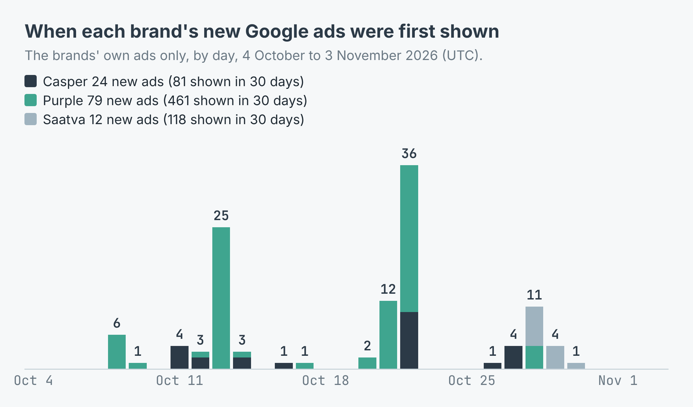
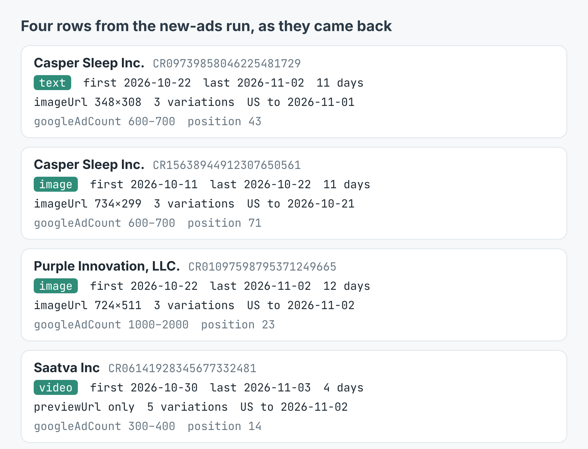
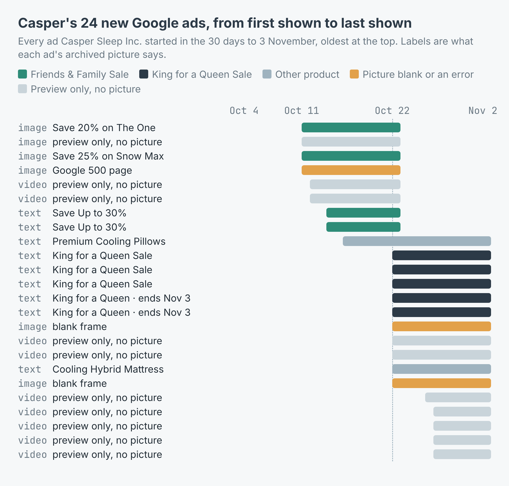

# Competitor Google ads scraper: every ad a rival started in the last N days

Give it a website. It reads Google's **Ads Transparency Center**, where
Google lists every ad an advertiser runs, keeps the ads first shown in the
last N days, prints them by format and by the day each one started, and
writes them to `ads.csv`: first and last shown, days shown, format,
advertiser, a picture of the ad or a link to Google's preview, and the ad's
own page in the Center.

These scripts call [Google Ads Transparency Scraper](https://apify.com/simple.actor/google-ads-transparency)
on Apify. No Google account, no API key, no browser.



The write-up, with real runs on three mattress brands, is
[How to see every Google ad a competitor started this month](https://simple-actor.github.io/see-every-google-ad-competitor-started-this-month-mattress-brands/)

## Run it

You need an [Apify](https://apify.com) account and its API token, from
Console → Settings → API & Integrations.

**Node** (20 or newer):

```bash
cd node
npm install
APIFY_TOKEN=your_token node new-ads.mjs casper.com 14
```

**Python** (3.10 or newer):

```bash
cd python
python -m venv .venv && . .venv/bin/activate
pip install -r requirements.txt
APIFY_TOKEN=your_token python new_ads.py casper.com 14
```

The first argument is the website, the second how many days back (default
30). The Node script on casper.com, 14 days, on 3 November 2026:

```
Google holds 600-700 ads for casper.com
17 first shown in the last 14 days
  image  4
  text   6
  video  7
first shown, by day:
  2026-10-21 2
  2026-10-22 10
  2026-10-26 1
  2026-10-27 4
advertisers: 3
```

"advertisers" counts every advertiser whose ads point at the site, not only
the brand itself. To see only what ran in one country, add `region: "US"` (or
`"GB"`, `"DE"`…) to the input in the script; `adFormat` takes `text`, `image`
or `video`.

## What a row looks like

[`sample-output.json`](sample-output.json) holds four real rows from the
new-ads run: two Casper ads, a Purple image ad and a Saatva video ad, with
`includeAdDetails` on, so each carries the countries it ran in and its
number of variations.



The fields you will use most:

| Field | What it holds |
|---|---|
| `adId`, `advertiserId` | Google's IDs; `adId` stays the same between runs, so dedupe on it |
| `advertiserName`, `advertiserCountry` | Who runs the ad and where they are based |
| `format` | `text`, `image` or `video` |
| `firstShown`, `lastShown`, `daysShown` | When Google first and last showed the ad (UTC), and for how many days |
| `imageUrl`, `previewUrl` | Google's archived picture of the ad, or a link to its preview script |
| `adUrl` | The ad's page in the Transparency Center |
| `regions`, `variations` | With `includeAdDetails`: each country it ran in, and how many variations it has |
| `googleAdCountMin`, `googleAdCountMax` | Google's own count of ads for the website |
| `type`, `error`, `errorDescription` | `type` is `"error"` on a line that could not be looked up; check for it rather than trusting the run status |



## What it costs

$0.0005 per ad returned, and another $0.0005 per ad when `includeAdDetails`
is on. No start fee. With `firstShownSince`, only the ads kept are charged,
so a high `maxAds` costs nothing extra: it sets how far down the list new
ads are looked for. The 136 new ads from three mattress brands, with
details, cost $0.136; the 14-day Casper run above cost $0.0085. A line that
cannot be looked up is never charged.

## Where it falls short

- **Most ads aren't text.** Of the three brands' 115 new ads, 31 had a
  picture and 84 only a `previewUrl`. Every video ad is preview-only.
- **Some pictures aren't the ad.** 8 of those 31 were a blank frame, a
  frame cut off mid-sentence, or Google's own 500 error page.
- **`lastShown` is the last day Google had recorded.** For an ad that's
  still running, that's usually yesterday.
- **An ad count is not a budget.** The Center says what ran and when, not
  what it cost.
- **Political ads aren't covered.** They live in a separate part of the
  Center.
